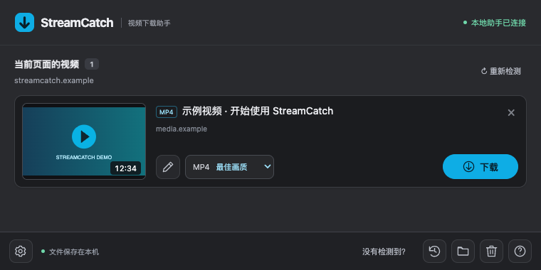

# StreamCatch · 视频下载助手

在 Chrome 中识别网页视频，选择画质并下载到本机。Mac 助手自动合并音画，输出 QuickTime 兼容的 MP4。

**[⬇ 下载 Mac 完整安装包](https://github.com/haoqiu123/StreamCatch/releases/latest/download/StreamCatch-macOS.zip)** · **[查看最新版与更新说明](https://github.com/haoqiu123/StreamCatch/releases/latest)**

> 这是 GitHub 安装版，尚未上架 Chrome 应用商店。扩展无需编译、npm 或开发工具；首次安装需要在 Chrome 中开启开发者模式并加载文件夹。



## 安装只需这几步

1. **下载并解压**上面的 Mac 完整包，把 `StreamCatch` 文件夹放到长期保留的位置，例如“文稿”。
2. **加载扩展**：在 Chrome 地址栏输入 `chrome://extensions`，打开右上角“开发者模式”，点击“加载已解压的扩展程序”，选择 `StreamCatch/extension`。
3. **安装 Mac 助手**：双击 `安装Mac助手.command`，按提示安装依赖。首次需要 [Homebrew](https://brew.sh/)；已有 Homebrew 的用户通常只需确认一次依赖安装。
4. **开始下载**：打开视频网页并播放几秒，点击工具栏上的 StreamCatch；显示“本地助手已连接”后，选择画质并点击“下载”。

**下载位置：Finder → 下载 → StreamCatch。** 关闭弹窗不会停止下载，请保持浏览器运行。

[详细中文安装指南](docs/INSTALL.md) · [隐私与权限说明](docs/PRIVACY.md) · [常见问题](#常见问题)

## 能做什么

- 视频卡片显示网页提供的封面、标题和时长，同一视频的多个来源尽量合并。
- 支持直接媒体、HLS，以及通过 Mac 助手处理 DASH 和音画分离。
- 最佳画质或最高 480p / 720p / 1080p / 4K 上限选择。
- Mac 助手检查实际轨道、完整音画和时长，需要时转换为 H.264 / AAC MP4。
- 弹窗中查看进度、取消任务、显示下载文件；关闭弹窗后继续下载。
- 登录状态按需授权，仅交给本机助手。

无法保证所有网站均可下载。DRM、网站权限、链接过期和站点变化都可能影响结果。不提供 Widevine 密钥提取或 CDM 破解。

## 系统支持

| 组件 | 支持情况 |
| --- | --- |
| 浏览器扩展 | 桌面版 Chrome 120+；Edge、Brave 可尝试加载 |
| 本地下载助手 | macOS，使用 Homebrew、Python、FFmpeg、Node.js、yt-dlp、curl_cffi |
| Windows / Linux | 可加载扩展；本仓库暂未提供对应本地助手安装器 |
| Safari / 手机浏览器 | 暂不支持 |

建议使用 Homebrew 当前支持的 macOS。Intel Mac 和旧版 macOS 的依赖安装情况以 [Homebrew 官方说明](https://docs.brew.sh/Installation) 为准。

只需要扩展文件时：[下载扩展包](https://github.com/haoqiu123/StreamCatch/releases/latest/download/StreamCatch-extension.zip)。Mac 用户建议使用完整包，弹窗一键下载依赖本地助手。

## 常见问题

**为什么不能点一下就安装到 Chrome？** 目前发布的是 GitHub 安装版。Chrome 商店式直接安装需要另行上架并通过审核；不要把 ZIP 拖入网页，按上面的“加载已解压”步骤安装。[Chrome 官方说明](https://developer.chrome.com/docs/extensions/how-to/distribute)

**没有发现视频？** 在原网页播放几秒，点击“重新检测”；也可点击“没有检测到？”让助手解析原网页。

**提示助手未连接？** 运行 `安装Mac助手.command`，等待出现“安装完成”，然后重新打开弹窗。不要删除或随意移动扩展文件夹。

**网站要求登录，或提示 403？** 先在原网页确认能正常播放，再重新检测；需要登录时，在插件齿轮设置中授权使用当前网站登录状态。403 不足以判断是否使用 DRM，不能保证通过补齐登录状态解决所有站点限制。

**下载中途断流？** 重新检测后重试。助手检查通过后才发布 MP4，失败不会把残缺文件标为完成。

**更新怎么做？** 解压最新版，替换原目录中的扩展和安装文件；在扩展管理页点击 StreamCatch 卡片上的“重新加载”，再运行一次 Mac 助手安装脚本。完整步骤见[更新指南](docs/INSTALL.md#更新)。

## 开发与打包

扩展源码位于 `extension/`，无需构建即可加载。助手源码位于 `native/`。

```sh
# Node.js 22+，不需要 npm install
npm test
npm run check

# Python 单元测试，需要 yt-dlp
python3 -m pip install 'yt-dlp[default]>=2026.10.26'
python3 -m unittest discover -s tests -p '*_test.py'

# 生成干净的发布包和 SHA-256 校验文件
python3 scripts/package-release.py
```

发布包写入 `dist/`，只包含运行文件和公共说明，不包含本机安装记录、浏览器数据、下载历史或测试视频。第三方下载器和转码组件由安装脚本从 Homebrew / PyPI 获取，未随仓库捆绑。

反馈问题请到 [Issues](https://github.com/haoqiu123/StreamCatch/issues)。请提供版本、浏览器、系统、脱敏后的错误文字及可公开的复现链接；不要提交 Cookie、密码、解密密钥、私密媒体或带签名的下载地址。
